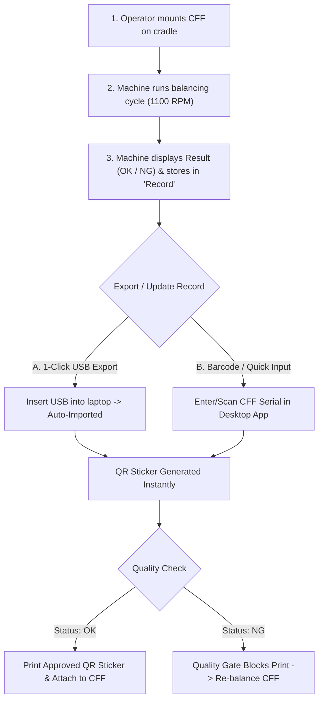

# Operator & Engineering User Manual — CFF QR Automation System

**Machine:** Shanghai Jianping Dynamic Balancing Machine Co., Ltd. (Model: PHGS-5D)  
**System Version:** CFF Master QR Automation v1.2  
**Target Workpiece:** Cross Flow Fans (CFF)  

---

## 1. System Overview & Technical Architecture

Your production line contains ten dynamic balancing machines. Eight machines use an industrial Windows PC running `MicroBalance DoublePlane`, while the two latest Chinese units use an embedded **Kunlun Tongtai (MCGS) touch panel**.

Shanghai Jianping quoted **USD 7,000 per machine** to replace the embedded controller with the PC unit. This software system completely eliminates the need for that $7,000 upgrade by providing:
1. **Automated QR Generation Engine:** Formats full balancing data (Plane 1, Plane 2, Angle, Weight, Speed, OK/NG) into industrial-grade QR code thermal labels.
2. **Quality Gate Protection:** Enforces tolerance rules so defective (`NG`) fans cannot receive an approved sticker.
3. **Traceability Database:** Records every test in a persistent SQLite database (`cff_balancing_records.db`) for quality audits and CSV/Excel export.
4. **Direct Desktop Launcher:** Double-click `Launch_CFF_QR_App.bat` on the Windows Desktop.

---

## 2. Daily Production Workflow for Operators

### Step 1: Balancing Operation
1. Place the CFF rotor on the rollers/bearings.
2. Press **Start** on the touch screen.
3. Wait for the cycle to conclude at ~1100 RPM.
4. The machine records the test in the internal database table (`Serial Number` #9677, #9678, #9684, etc.).

### Step 2: Generating & Printing the QR Sticker
1. Double-click **`Launch_CFF_QR_App.bat`** on your Desktop.
2. In the application:
   - Verify the values for Plane 1, Plane 2, and Result (`OK` / `NG`).
   - Click **`GENERATE QR STICKER`**.
   - Click **`PRINT STICKER TO THERMAL PRINTER`**.
3. Attach the printed sticker to the qualified CFF fan before packaging.

---

## 3. Configuring QR Rules (Tab 2)

Inside the application's **"2. QR Generation Rules"** tab, production supervisors can configure:
1. **Encoding Format:**
   - `JSON`: Best for automated optical scanners, mobile inspection apps, and MES databases.
   - `Delimited CSV`: Matches legacy factory ERP formats.
   - `Cloud Verification URL`: Opens a web certificate for customer validation.
2. **Serial Number Logic:**
   - Auto-incrementing daily counter (`CFF-YYYYMMDD-001`).
   - Barcode Scanner input (scans physical rotor barcode).
3. **Quality Gate:**
   - Checkbox: *Only allow printing when Balancing Result is OK*.

---

## 4. Quality Audit & History (Tab 3)

The **"3. Quality Records & Traceability"** tab maintains a permanent record of all balanced units:
- View timestamps, rotor part numbers, plane 1 & plane 2 weights/angles, and pass/fail verdicts.
- Click **`Export to Excel / CSV`** at any time to generate quality control reports for plant management.
